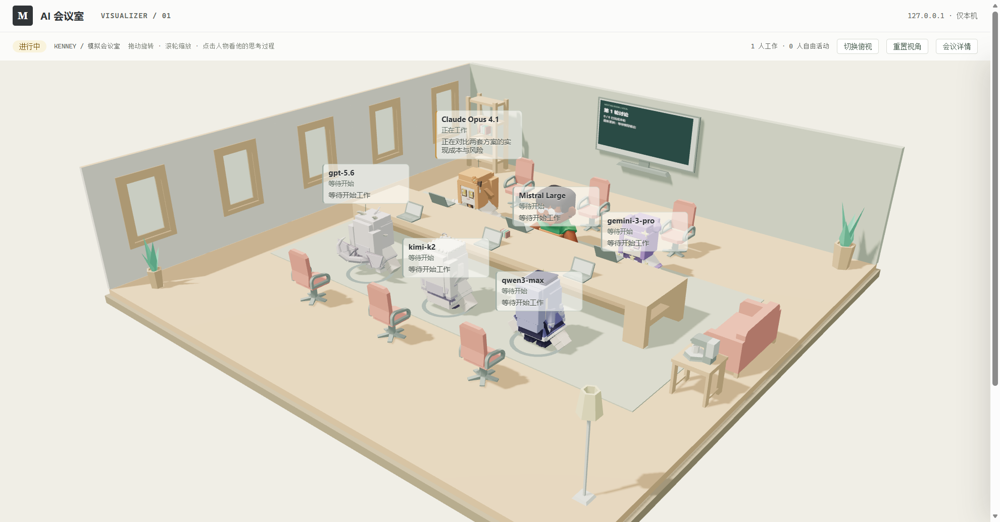
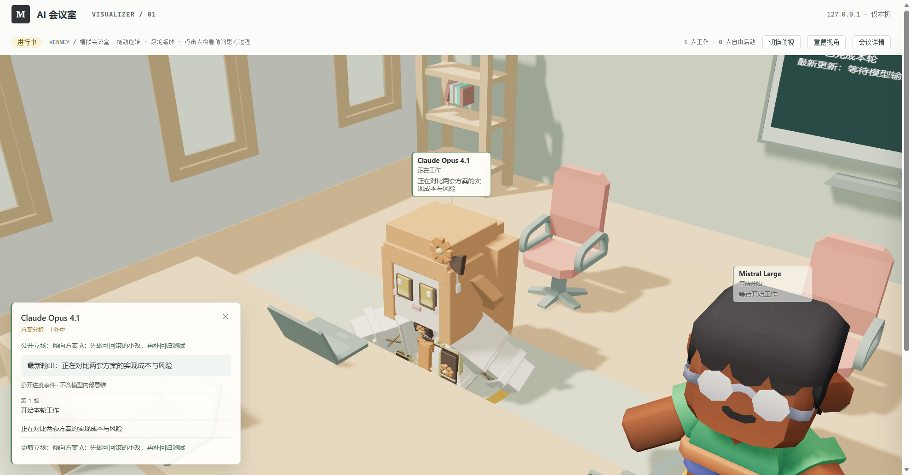
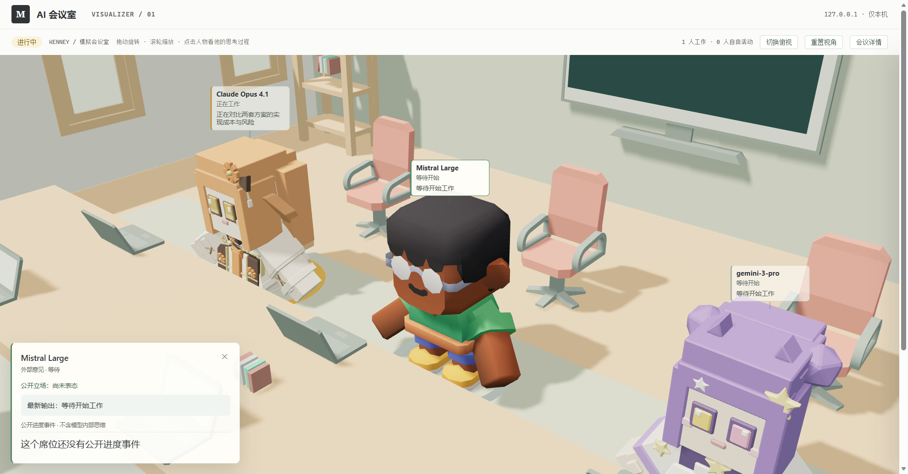
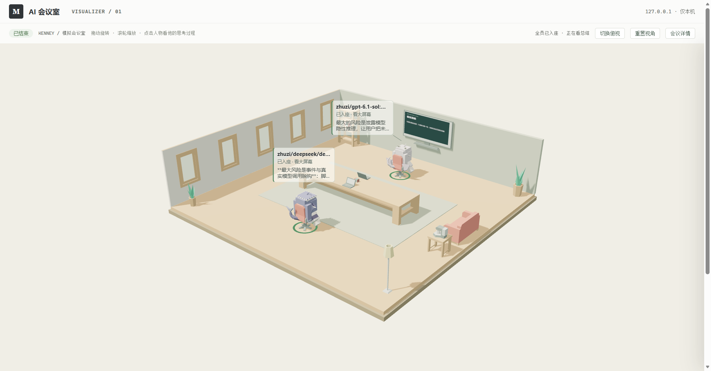

# pi-ai-meeting-visualizer

`pi-ai-meeting` 的独立浏览器可视化插件。

它负责把会议状态显示成一个可观察的本地会议室：角色入座、思考、发言、交叉质询、投票、完成后离开会议桌。核心会议插件不依赖本项目，也不包含本项目的模型资源。

## 目标边界

- 服务只监听 `127.0.0.1`
- 浏览器通过本地链接访问，不使用 Electron 或 WebView
- 会议结束后保留最终画面，服务由用户主动停止；空闲回收尚未实现
- 3D 资源首次使用时自动下载并缓存，不进入仓库提交
- 视觉状态只消费会议事件，不读取模型内部调用细节

## 目录

```text
extensions/  Pi 扩展入口：/meeting 命令与 meeting_visualizer 工具（start/stop/status/open）
server/      本地 HTTP 服务与会议事件桥
web/         浏览器页面和场景渲染器
protocol/    核心插件与视觉插件之间的事件协议
assets/      资源目录：Kenney 下载缓存、各厂家自制角色 GLB、插件运行截图
```

## 开发顺序

1. 先实现本地服务和事件协议
2. 用模拟事件驱动浏览器页面
3. 加入桌子、椅子、角色状态和气泡
4. 先用 Kenney 人物和家具验证 3D 会议室
5. 接入 `pi-ai-meeting` 的真实会议事件：已做完自动跟随、逐席结论（含交叉质询轮）、`/meeting` 命令与三个自动开关；下一步是投票/验收轮的跟随

## 当前原型：Kenney 3D 会议室

已经实现 Node 标准库 HTTP 服务、内存会议事件和增量轮询。浏览器使用 Three.js 将 **Mini Characters + Furniture Kit** 拼成斜俯视会议室：四种默认人物、会议桌、办公椅、笔记本、墙面屏幕、书柜、沙发、咖啡角和绿植；席位按模型名换成对应厂家的自制角色（GPT、Claude、Gemini、Grok、DeepSeek、Kimi、GLM、Qwen），认不出的厂家用默认人物顶替。

人物旁显示各自模型名称和持续更新的进度框，电脑屏幕朝向使用者。提前完成的人会离桌摸鱼：先去自己半区的一件小事（看窗外、盯大屏幕、翻书柜、给绿植浇水），再去椅后过道散步，再换成另一件事（窝在沙发上玩手机、在咖啡角拿着杯子），每人顺序不同、每轮接着上一轮往下走；路上会绕开会议桌和椅子，不会穿模。最后一个人完成后，全员回椅子、转向大屏幕，等全部到位再显示会议总结。新一轮开始会中断摸鱼并返回电脑前，不阻塞模型事件。

会议结束保留人物与最终结论，也可切换俯视角度。会议页是全屏数字孪生视图：3D 场景铺满整个窗口，顶部只剩一行状态条（阶段、在场人数、操作提示、切换俯视、重置视角、会议详情）。标题、会议结论、席位列表和事件记录全部收进右侧的 **会议详情** 抽屉，默认收起、点一下滑出；首页（还没进会议）保留原来的说明与会议列表布局。模型未下载或 WebGL 不可用时，仍能查看原有 CSS 占位角色和完整文字状态。所有演示文字和模型名称都是模拟数据，不会调用任何模型。

### 席位角色



角色只看席位的模型名（先是 `model`，再看 `label` 和席位 id）：出现 `gpt`、`claude`、`gemini`、`grok`、`deepseek`、`kimi`、`glm`、`qwen` 等厂家关键词就用对应厂家的自制角色；Claude 的档位名 `opus`、`sonnet`、`haiku`、`fable` 没有厂家前缀，同样归到 Claude。**认不出或没有自制角色的厂家（Mistral 等）按席位顺序轮换四个 Kenney 默认角色**，同一场会议不会重样。





厂家关键词表在 `web/scene-cast.mjs`，自制角色清单与文件路径在 `assets/manifest.mjs`；角色的建模源文件、四视角预览图和参考图在单独的角色仓库 `pi-meeting-chibis`，本仓库只放运行时要读的 `character-*.glb`，详见 [assets/README.md](assets/README.md)。

### 自由视角与席位聚焦

- 视角可以自由移动：拖动旋转、滚轮缩放、右键（或双指）平移。**重置视角**回到默认斜视，**切换俯视**在两套预设机位间切换；用户还没自己转过镜头时，窗口尺寸变化会重新取景，之后只重算宽高比
- 点击任意一个人物（或会议详情抽屉里的席位卡片）就聚焦到他身上：镜头拉近、保持当前观察方向，并一路跟着他走，他离开工位去摸鱼也不会丢
- 聚焦时左下角出现席位档案：模型名、职责、公开立场、按轮次分组的公开进度（会议脚本愿意发出来的那段）与每轮结论。点 ✕ 或重置视角取消聚焦，镜头退回聚焦前的位置
- 聚焦面板只汇总该席位最近的 40 条公开事件；被推出画面的人物气泡会隐藏，不会挤在画面边缘
- 鼠标移到人物上会高亮他和他的气泡，光标变成手型；自由视角下滚轮朝鼠标位置推进，聚焦时改为围绕人物缩放
- 键盘：`Esc` 取消聚焦，`R` 重置视角（按钮上也有提示）
- 场景实时反映数据：最近推送事件的席位圆环呼吸更快、气泡状态前带一个绿点；每收到新事件，那个人的圆环会弹一下
- 墙上的大屏幕是这间房的仪表盘：进行中写「第 N 轮讨论 / n / 总人数 已完成本轮 / 最新更新：谁在做什么」，回座阶段写入座进度，结束时写最终结论

### 安装

作为 Pi 扩展安装（要求 Node.js 22 或以上）：

```sh
pi install git:github.com/ArnoldRedman/pi-ai-meeting-visualizer
pi list | grep visualizer      # 确认在列表里（cmd 用 findstr）
```

最快一次上手：

1. 装完**重开一个 Pi 会话**（已经开着的会话要重启或 `/reload` 才会加载新插件）
2. 用 [pi-ai-meeting](https://github.com/ArnoldRedman/pi-ai-meeting) 开会——插件会自己认出 `meeting.js`，把房间拉起来，并在 pi 里给你一条门牌链接（`/meeting/<会话 id>`），点开就能看
3. 只想先看看长什么样：`/meeting open`，页面上点「开始模拟会议」会跑一场内置模拟会议
4. 随时控制：`/meeting status` 看状态、`/meeting stop` 停服务、`/meeting config` 改自动行为

装完后在 Pi 里用 `/meeting` 控制会议室：

| 命令 | 作用 |
| --- | --- |
| `/meeting start`（默认） | 拉起本地服务，返回 `http://127.0.0.1:34721/`；首次会自动下载并缓存 Kenney 资源 |
| `/meeting open` | 启动（若未启动）并用默认浏览器打开会议列表 |
| `/meeting status` | 服务在不在跑、当前有几场会议、各自进行到第几轮 |
| `/meeting stop` | 停掉本会话启动的服务 |
| `/meeting config` | 改三个开关（见下），不带参数时逐项问 |

模型也可以直接调用 `meeting_visualizer` 工具完成 start/stop/status/open（动作名相同）；设置只走 `/meeting config`。服务是会话级资源：Pi 退出时会自动停掉，会议数据只存在内存。端口默认 `34721`，用 `MEETING_PORT`（或 `PORT`）改；端口被占用时明确报错，不自动切换。

### 设置

三个开关存在 Pi 配置目录下的 `meeting-visualizer.json`（默认 `~/.pi/agent/meeting-visualizer.json`，与 `ai-meeting.json` 同处）：

| 设置 | 默认 | 说明 |
| --- | --- | --- |
| `autoStart` | `true` | 会议开始时自动拉起可视化服务；关掉后会议不再自动跟随（要看得先 `/meeting start`） |
| `autoOpen` | `false` | 会议开始时自动用默认浏览器打开页面 |
| `autoStopSeconds` | `0` | 会议结束后过多少秒自动停掉服务，`0` = 不自动停 |

```sh
/meeting config                            # 看当前设置（TUI 里逐项选）
/meeting config autoStart off              # 不自动起服务，需要时自己 /meeting start
/meeting config autoOpen on                # 开会就跳浏览器
/meeting config autoStop 30                # 会议结束后 30 秒自动收工
```

自动停只会停本会话自己拉起来的那个服务（别的会话在用的不碰）；`/meeting stop` 随时能立即停。所有自动行为都只影响可视化，不会改动会议本身。

### 开会时自动出现

装了 [pi-ai-meeting](https://github.com/ArnoldRedman/pi-ai-meeting) 的会话里**不用手动敲命令**：只要 `subagent` 开始跑它的 `meeting.js`，插件就认出这场会议、自动把服务拉起来，并在 pi 里 notify 一个门牌（`/meeting/<会话 id>`）。



- 席位直接取 `args.seats`（名字 → 该厂家的角色），`round_started` 和全员 `seat_started` 一次发完——`runs.all` 本来就让所有席位同时开跑
- ai-meeting 默认 `async: true`，所以启动后先拿到的只是执据。跟随靠会议运行目录里的两个文件：每 5 秒读一次子会话台账 `workflow-children.jsonl`（每开一个子会话一行 `start`、交卷一行 `settle`，`settle` 里带这个子会话的完整输出），`status.json` 只在整轮收尾时读 `state` 和完整的 `workflow.value`。子会话完成通知（`role: custom`）指望不上：Pi 的 `message_start` 只对 user / assistant / toolResult 触发，custom message 不触发它
- 一个席位交卷就立刻发 `seat_finished`，正文取它自己的输出（超长留尾部，不切掉末行的【结论】），末行的【结论】再当公开立场发一条 `stance_changed`：点开它就能看到这一轮说了什么，不必等整轮跑完
- 第二轮（交叉质询）的子会话 key 是 `<席位 key>-r2`（resume 被拒时补 `-r2-fresh`）：一看到它就先发 `round_started`、再发该席位的 `seat_started`，于是去摸鱼的人被叫回电脑前，逐个交卷逐个出结论；哪个席位在第一轮没给出答案就不参与质询，房间会把它收成「没有等到结论」
- 最后发 `meeting_finished`，摘要只写客观事实（几席参与、几席失败、几席改判），不编结论、不替脚本算票

**粒度限制（真实存在，不是偷懒）**：轮次内的实时进度（谁先想到什么、思考到第几步）拿不到，也不该去读——那些内容在各席位自己的会话里，读它等于读模型内部调用细节。房间只读会议脚本愿意公开的东西：子会话台账里的最终输出与末行【结论】。会议脚本自己的返回值（票型、逐席汇总）仍要等整轮跑完才落盘，所以总结和大屏幕上的结论出现在最后。中途失败的那一席会按实际状态显示。

自动跟随只认 `workflow` 指向 `meeting.js` 且带 `args.seats` 的调用；识别不到就当没这回事，不影响会议本身。发事件失败只会在 pi 里报一条警告。

### 跑本仓库

想改代码或看页面而不装扩展：

```sh
npm install
npm run assets:fetch
npm start
```

后续只需 `npm start`。HTTP 服务仍仅使用 Node 标准库；仅增加 Three.js（渲染）与 fflate（资源 ZIP 解码），不需要前端构建、框架或数据库。

`assets:fetch` 从 Kenney 官方下载约 7.2 MB 的两个 CC0 压缩包，验证固定 SHA-256 后只提取当前场景需要的 17 个 GLB、角色贴图和授权文件。模型、贴图和下载包均写入被忽略的 `assets/cache/kenney/`，**不进入源码提交或 npm 包**；各厂家的自制角色是仓库里的 `assets/models/characters/*.glb`，随包发布，不需要下载。已有下载缓存时可离线重建；浏览器本身只从本地服务读取模型，不访问 CDN。

授权与缓存结构见 [assets/README.md](assets/README.md)。

浏览器打开 **http://127.0.0.1:34721/**，点击 **开始模拟会议**。页面会跳转到：

```text
http://127.0.0.1:34721/meeting/demo-<随机 UUID>
```

约 25 秒内依次显示：会议开始 → 四个席位工作 → 公开进度与立场变化 → 第一轮完成 → 第二轮 → 最终结论。可以回首页创建另一场模拟，多个 session 独立运行。

- 刷新或重新打开会议链接会重放已保存事件，恢复当前或最终画面
- 会议结束不关页面、不停止服务；按启动终端里的 **Ctrl+C** 主动停止
- `npm run dev` 启用 Node 文件监视；代码变化会重启服务并清空内存会议
- `npm test` 运行 Node 内置测试，不调用模型、不下载资源
- 用 `pi install` 装的是同一份代码；扩展只是把 `npm start` 包成了 `/meeting` 命令，两种启动方式不要同时用（端口会撞）
- 版本号按 **0.1 递增**（0.1.0 → 0.2.0 → 0.3.0），每推一次功能更新加一位

PowerShell 自定义端口示例：

```powershell
$env:PORT=34722; npm start
```

### API

| 方法与路径 | 用途 |
| --- | --- |
| `GET /health` | 服务状态与 session 数量 |
| `GET /api/sessions` | 列出本进程中的会议 |
| `GET /api/sessions/:id` | 单场会议的状态摘要 |
| `POST /api/sessions/:id/events` | 追加一个 JSON 事件；首个事件必须为 `meeting_started` |
| `GET /api/sessions/:id/events?after=0` | 按序号增量读取事件 |
| `POST /api/demo` | 以空 JSON 对象 `{}` 创建并启动独立模拟会议（四个席位、两轮，进度与结论都是接近真实的成段文本，可以直接拿来试“点人物看输出”） |
| `GET /meeting/:id` | 浏览器会议页面 |

接口示例和字段约束见 [server/README.md](server/README.md) 与 [protocol/meeting-events.md](protocol/meeting-events.md)。

### 当前限制

- **所有会议只在内存中**：刷新网页不会丢失记录，停止或重启服务会清空记录
- 每个服务最多 64 个 session，每个 session 最多 1,000 个事件，服务合计最多 10,000 个事件；达到上限拒绝写入，不自动删除旧会议
- 页面按 0.7 秒增量轮询，会议详情抽屉里的事件记录显示最近 80 条；完整事件仍可通过 API 获取
- 请求体上限 16 KiB；本地 HTTP 只接受同源浏览器请求及本机 CLI，不提供 CORS 或公网访问
- 没有本机进程身份鉴权，同一机器上的其他进程仍可调用 API；不要转发或代理到公网
- 人物活动使用当前房间内的固定椅后过道，不穿过会议桌；尚未引入通用寻路、走入/离场或坐姿 IK
- 人物旁气泡展示模型名、活动状态和最近进度（长文本截到两行），完整正文在会议详情抽屉的席位列表、以及聚焦面板的「本轮结论」里；单个席位的逐轮公开进度与结论在聚焦面板里看
- 可视化只展示事件里带的公开文本；席位输出有多详细取决于上游写进 `seat_progress.message` / `seat_finished.message` 的内容，可视化不做摘要或改写
- 相机是 30° 视场角的透视相机：默认机位按房间尺寸自动取景，近距离看人物时有明显的近大远小；转到房间背面时视线仍会被墙挡住
- 聚焦入口目前只有指针点击（3D 人物或抽屉里的席位卡片），键盘还无法选择席位；聚焦面板本身是普通 DOM，可正常阅读和关闭
- 大屏幕只在全员回座并转向后显示总结；完整文字结论仍随事件立即更新，二者不会互相阻塞
- 场景最多支持协议约定的 16 个席位；同一厂家的多人共用同一套骨骼模型，各自独立克隆，互不影响
- 限制像素比到 1.5、动画约 30 FPS；页面隐藏或场景滚出视口时暂停循环，支持系统减少动态效果设置
- 会议粒度是“轮”：会议脚本用 `runs.all` 等全体席位一起收口，所以房间呈现的是“全员并行工作 → 一个个交出结论”；席位内部的推理过程不展示（去读它等于读模型内部调用细节，本项目不碰）
- 只识别 `workflow` 指向 `meeting.js` 且带 `args.seats` 的 `subagent` 调用；当前只跟随 `meeting.js` 这一场，后续的投票/验收轮暂未接
- 服务与会话数据只在内存（Pi 退出即停）；没有 SSE/数据库/账号/多用户，也不提供公网访问；扩展首次启动会自动联网下载并校验 Kenney 资源（之后走缓存）

### 许可

本仓库（含随包发布的 8 个角色模型）采用 [CC BY-NC-SA 4.0](LICENSE)，与角色仓库 pi-meeting-chibis 一致：允许自由使用、修改、再分发，**禁止商业使用**，分发需保留署名并以同一许可证发布。商业授权与其它例外事项见 [NOTICE.md](NOTICE.md)（品牌标志、Kenney CC0 资源、Three.js / fflate 的归属都写在那里）。

`pi-ai-meeting` 核心项目不需要做任何修改，可视化插件单独安装即可。
